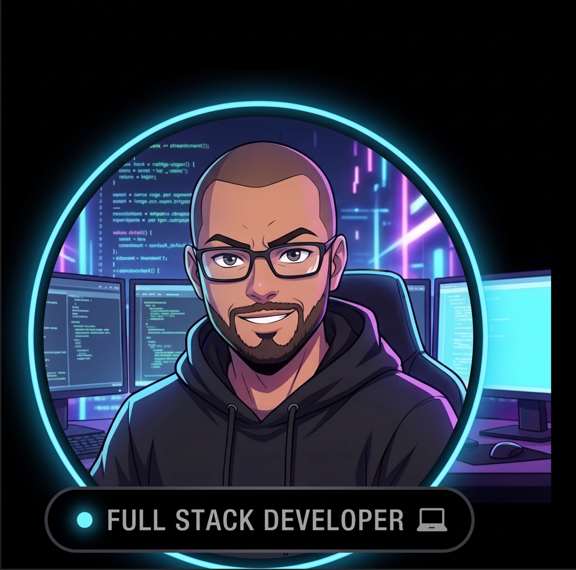

<table border="0">
  <tr>
    <td width="70%">
      <h1>👋 Olá, eu sou o José Alberto</h1>
      

        
      

    </td>
    <td width="30%" align="center">
      
    </td>
  </tr>
</table>

---

### 👨‍💻 Sobre mim
- 🎓 Cursando **MBA em IA & Automação de Negócios**
- 🎨 Interfaces **responsivas, acessíveis e bem estruturadas**
- ⚙️ Construindo APIs com **Node.js, Prisma e MongoDB**
- 💬 Curioso, comunicativo e em constante aprendizado

---

### 🧰 Tecnologias

  
  
  
  
  
  
  
  
  

**Ferramentas:**

  
  
  

---

### 📊 Minhas Estatísticas

---

### 🔗 Conecte-se comigo

---

<picture align="center">
  <source media="(prefers-color-scheme: dark)" srcset="https://raw.githubusercontent.com/josealbertodeev/josealbertodeev/output/github-contribution-grid-snake-dark.svg">
  
</picture>
